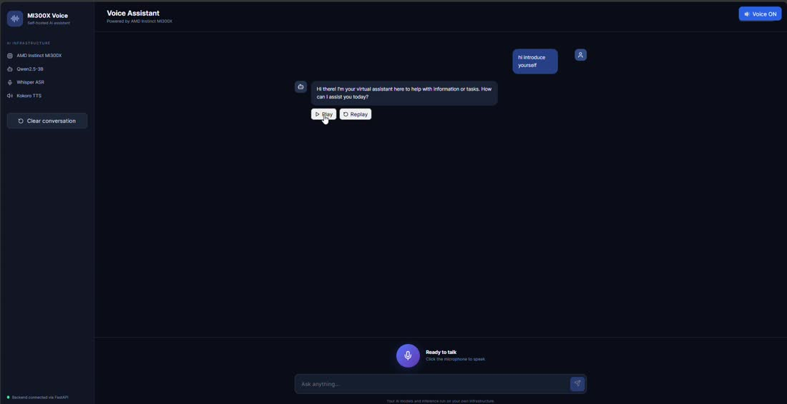
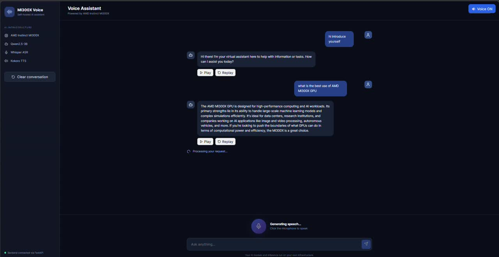
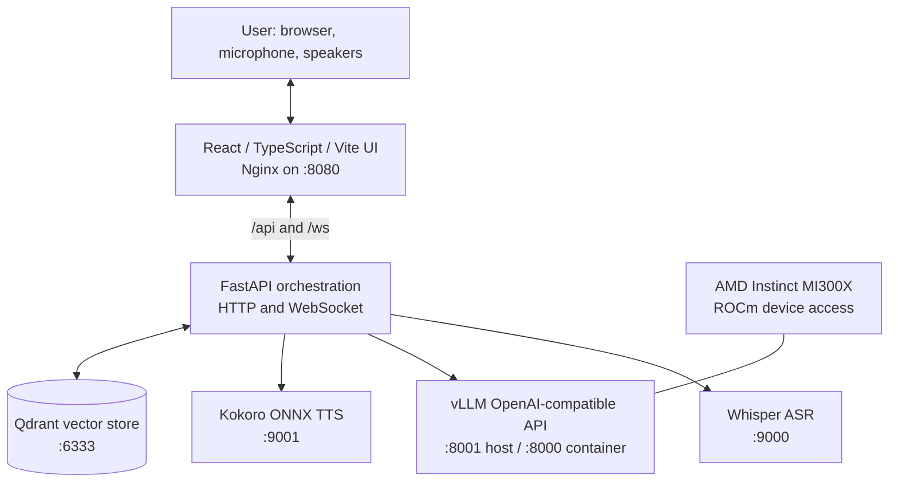
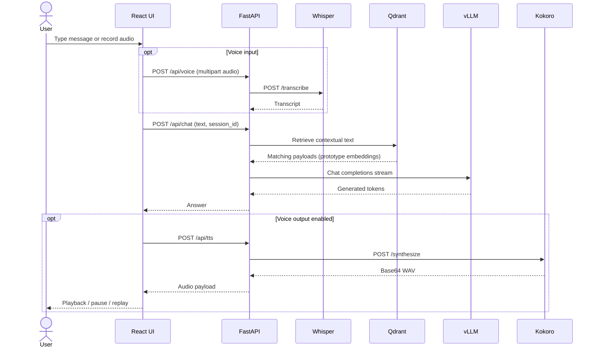
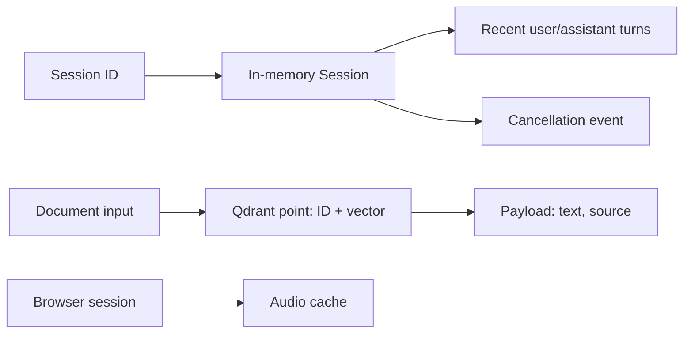
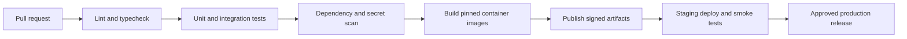

<div align="center">

# AMD MI300X Voice Agent

### Self-hosted, GPU-accelerated conversational AI with speech-to-text, language reasoning, and natural speech synthesis

**AMD Instinct MI300X · ROCm · vLLM · Whisper · Kokoro · FastAPI · React · Qdrant · Docker**

[](https://fastapi.tiangolo.com/) [](https://react.dev/) [](https://rocm.docs.amd.com/) [](https://docs.docker.com/compose/)

[**Demo**](#demo--screenshots) · [**Architecture**](#architecture) · [**Quick Start**](#quick-start) · [**API Reference**](#api-reference) · [**Security**](#security--threat-model) · [**Roadmap**](#roadmap)

</div>

> **Project status — functional MVP / production hardening in progress.** The application has a working self-hosted voice-chat stack. It is **not** represented as security-certified, highly available, independently benchmarked, or ready for unrestricted public exposure. This distinction is intentional.

## Table of contents

- [Overview](#overview)
- [Problem statement and product goals](#problem-statement-and-product-goals)
- [Demo and screenshots](#demo--screenshots)
- [Features and implementation status](#features--implementation-status)
- [Architecture](#architecture)
- [Technology stack](#technology-stack)
- [Quick start](#quick-start)
- [Configuration reference](#configuration-reference)
- [Usage and UI walkthrough](#usage--ui-walkthrough)
- [API reference](#api-reference)
- [Data design and persistence](#data-design--persistence)
- [Project structure](#project-structure)
- [Security and threat model](#security--threat-model)
- [Performance and capacity planning](#performance--capacity-planning)
- [Scaling, resilience, and recovery](#scaling-resilience--recovery)
- [DevOps and observability](#devops--observability)
- [Testing and quality gates](#testing--quality-gates)
- [Tradeoffs and design decisions](#tradeoffs--design-decisions)
- [Challenges and lessons learned](#challenges--lessons-learned)
- [Roadmap](#roadmap)
- [Contributing](#contributing)
- [License, authors, and acknowledgements](#license-authors--acknowledgements)

## Overview

**AMD MI300X Voice Agent** is a browser-accessible AI assistant that runs its model-serving stack on customer-controlled infrastructure. Users can type or speak a question; the platform routes it through a FastAPI application to a locally hosted language model, and can return a synthesized spoken response. The application separates the browser, API, speech recognition, text generation, speech synthesis, and vector storage into independently managed services.

**Intended audience:** AI infrastructure engineers, platform teams, AMD GPU developers, researchers, and organizations evaluating private conversational AI. This repository is a technical reference and evolving product prototype, not a managed SaaS offering.

### Problem statement and product goals

Commercial voice assistants frequently depend on remote inference endpoints and offer limited control over model selection, data movement, runtime configuration, or accelerator infrastructure. This project explores a **self-hosted alternative** that exposes understandable service contracts and can be adapted to private deployments.

**Goals:**

1. Deliver an end-to-end text and voice interaction loop using open tooling.
2. Run language-model inference on an AMD MI300X using ROCm-compatible serving.
3. Isolate ASR, LLM, TTS, API, UI, and knowledge services for maintainability.
4. Support a usable web experience with microphone capture, voice toggle, and replay controls.
5. Provide an auditable foundation for RAG, enterprise identity, telemetry, and scalable operations.

**Differentiators:** self-hosted inference; AMD ROCm-oriented model serving; explicit service boundaries; separate Kokoro speech synthesis; browser-based controls; and an architecture that can evolve without rebuilding the entire application.

## Demo & screenshots

### Recorded product walkthrough

[](docs/assets/demo.mp4)

**[▶ Watch the recorded demo (MP4)](docs/assets/demo.mp4)** · Recorded 23 October 2026 · Approximately 2 min 34 sec. The repository bundle includes a bandwidth-friendly, silent version of the supplied screen recording. It demonstrates the UI and interactions; it is **not** a load-test or production-readiness demonstration.

### Screenshots

| Chat and model details | Voice-enabled interaction |
|---|---|
|  |  |

Additional frames: [Initial screen](docs/assets/screenshot-4.jpg) · [Later conversation](docs/assets/screenshot-125.jpg).

### Live demo

**Local deployment:** `http://127.0.0.1:8080` after the services start. A public hosted demo URL has **not** been published. When the service runs remotely, use an SSH tunnel rather than assuming port 8080 is publicly reachable.

### UI walkthrough

1. Open the app; the sidebar identifies the underlying MI300X, language model, ASR, and TTS technologies.
2. Enter a message in the text composer and submit it.
3. Read the assistant's response in the conversation panel.
4. Use **Voice ON/OFF** to control automatic spoken output for text replies.
5. Use **Play**, **Pause**, and **Replay** on an assistant response to manage audio.
6. Click the microphone, grant permission, speak, and stop recording to send voice input.
7. Use **Clear conversation** to reset the browser-visible conversation.

**Mobile:** the responsive experience has not been formally validated across mobile devices. Microphone capture requires a secure context (HTTPS or localhost) and browser permission. **Login/dashboard:** no login screen or separate administrative dashboard is implemented; these are future features, not omitted screenshots.

## Features & implementation status

| Capability | Status | Implementation notes |
|---|---|---|
| Text conversations | Implemented | React UI → `POST /chat` → vLLM |
| Speech input | Implemented | Browser recording → Whisper ASR |
| Speech output | Implemented | Kokoro ONNX TTS, WAV returned as base64 |
| Voice ON/OFF | Implemented | Browser-level automatic playback setting |
| Play / Pause / Replay | Implemented | Per-message playback and client-side audio reuse |
| GPU LLM serving | Implemented | ROCm-compatible vLLM container, model configurable |
| API health endpoints | Implemented | `/health` and `/ready` (basic responses) |
| Prometheus-compatible metric | Implemented, limited | `/metrics` exposes a request counter |
| WebSocket token/audio messages | Implemented in API | `/ws/realtime/{session_id}`; frontend adoption should be validated separately |
| Qdrant document ingestion | Prototype | Text ingestion and retrieval endpoints exist; **embedding is a deterministic placeholder** |
| Conversation session state | Prototype | In-process memory, last 20 messages; not durable or distributed |
| Agent/tool execution | Not complete | Routing hints exist, but no verified production tool executor |
| Authentication and RBAC | Not implemented | Required before multi-user/public use |
| CI/CD, automated tests, HA | Not verified | Roadmap items, not claims of current coverage |

## Architecture

### High-level system diagram



### Service architecture and boundaries

| Service | Compose name | Internal port | Host port | Responsibility |
|---|---|---:|---:|---|
| Web | `web` | 80 | 8080 | SPA, reverse proxy for `/api/` and `/ws/` |
| API | `api` | 8000 | 8000 | Chat, voice, documents, sessions, metrics |
| LLM | `llm` | 8000 | 8001 | vLLM inference; enabled via `gpu` profile |
| ASR | `asr` | 9000 | 9000 | Whisper transcription |
| TTS | `tts` | 9001 | 9001 | Kokoro audio synthesis |
| Vector store | `qdrant` | 6333 | 6333 | Document-vector storage |

The Compose stack does **not** include PostgreSQL, Redis, Kafka, or a dedicated message queue. Do not infer they are running. Session memory is currently local to the API process. The web server proxies API calls and WebSocket upgrades to the backend.

### Request and data flow



The `POST /voice` endpoint also provides an integrated ASR → chat → TTS path. The WebSocket endpoint sends `token`, `audio`, `done`, and `interrupted` message types. It is not equivalent to a fully deployed low-latency bidirectional audio streaming protocol.

### Component responsibilities

- **Presentation:** React/TypeScript, browser MediaRecorder, audio playback cache, status and error messages.
- **Application:** FastAPI, Pydantic request validation, session state, model and service adapters.
- **Model:** vLLM OpenAI-compatible chat completions on an AMD ROCm-capable runtime.
- **Speech:** Whisper model loaded in ASR container; Kokoro ONNX model and voice assets loaded in TTS container.
- **Knowledge:** Qdrant collection and source-tagged text payloads; prototype embedding logic requires replacement.
- **Infrastructure:** Docker Compose, Docker networking, model cache and Qdrant persistent volumes.

## Technology stack

| Layer | Technologies |
|---|---|
| Frontend | React 19, TypeScript, Vite 6, Lucide React, Nginx |
| Backend | Python, FastAPI, Pydantic, HTTPX, WebSockets |
| AI serving | AMD MI300X, ROCm, vLLM, configurable Hugging Face chat model |
| Speech recognition | OpenAI Whisper |
| Speech synthesis | Kokoro ONNX, NumPy, SoundFile |
| Knowledge storage | Qdrant (vector database) |
| State | Python in-memory session dictionary; browser-side audio cache |
| Infrastructure | Docker Engine, Docker Compose; example Kubernetes manifests |
| Monitoring | Prometheus exposition endpoint (limited implementation) |
| DevOps | Git and GitHub; no verified automated CI pipeline |

**Model configuration note:** API settings default to `Qwen/Qwen2.5-3B-Instruct`, while the repository's `.env.example` currently suggests `google/gemma-3-4b-it`. Set **both** `VLLM_MODEL` (container model) and `VLLM_MODEL` in the API environment, or update the API default, so the API requests the model actually served. The current Compose file does **not** pass `VLLM_MODEL` into the API service. Verify model support and licensing for your chosen runtime.

## Quick start

### Prerequisites

- Linux host with AMD MI300X and compatible ROCm kernel/runtime stack for GPU inference.
- Docker Engine with Compose plugin (`docker compose version`).
- Access to model files or Hugging Face for initial model download.
- Network connectivity and enough memory/disk for the selected model and speech assets.
- Node.js 22+ **only** for local frontend development; Docker builds the frontend otherwise.
- `curl` for smoke tests.

### Clone

```bash
git clone https://github.com/Siddharthchandra123/AMD_Voice_agent.git
cd AMD_Voice_agent
```

### Configure runtime variables

The Compose file interpolates `HF_TOKEN` and `VLLM_MODEL` for the **LLM container**. You can supply them through your shell without creating a `.env` file:

```bash
export VLLM_MODEL='Qwen/Qwen2.5-3B-Instruct'
# Set HF_TOKEN only when the selected model requires authentication:
# export HF_TOKEN='your-token-from-a-secret-store'
```

**Important:** In the current repository, the API defaults to Qwen2.5-3B while the LLM image uses `${VLLM_MODEL}`. If you select a different model, edit `services/api/app/config.py` or pass the same `VLLM_MODEL` into the `api.environment` section of `docker-compose.yml` before launching. The supplied `.env.example` is a template, not a required secret file.

**Kokoro assets:** `services/tts/main.py` expects `/app/models/kokoro-v1.0.onnx` and `/app/models/voices-v1.0.bin` unless overridden. The current `services/tts/Dockerfile` must be checked for asset provisioning before the first build; ensure these files are present in the image or mounted appropriately. Do not commit model weights unless their licenses and repository size limits permit it.

### Validate and start

```bash
docker compose --profile gpu config
docker compose --profile gpu up -d --build
docker compose --profile gpu ps
```

### Smoke tests

```bash
curl --fail http://127.0.0.1:8000/health
curl --fail http://127.0.0.1:8000/ready
curl --fail http://127.0.0.1:8080/
```

A `/health` or `/ready` success means the **API route responded**, not that all dependent models are loaded or healthy. Check logs and execute an actual chat and TTS request for end-to-end verification.

### Access the UI

Open `http://127.0.0.1:8080` on the host. For a remote GPU server, use a local tunnel:

```bash
ssh -L 8080:127.0.0.1:8080 USER@YOUR_SERVER
```

Then visit `http://127.0.0.1:8080` on your laptop. Replace `USER@YOUR_SERVER` with your actual SSH target.

### Stop / inspect / rebuild

```bash
docker compose --profile gpu logs --tail=100 api web tts asr llm qdrant
docker compose --profile gpu up -d --build --no-deps --force-recreate web
docker compose --profile gpu down
```

Do not add `-v` to `down` unless you intend to remove named volumes and their stored data.

### Frontend development

```bash
cd services/web
npm ci
npm run dev
# In a second terminal, with API services available:
# npm run build
```

The Vite development proxy resolves `api` as a Docker service hostname; running Vite directly on your host may require changing `services/web/vite.config.ts` to target `http://127.0.0.1:8000` instead.

## Configuration reference

These are the configuration inputs **found in the current source**, not invented production settings.

| Variable | Current default / source | Used by | Purpose |
|---|---|---|---|
| `HF_TOKEN` | No default in Compose | LLM container | Optional Hugging Face model authentication |
| `VLLM_MODEL` | Required interpolation in Compose; API default `Qwen/Qwen2.5-3B-Instruct` | LLM / API | Model ID; **must be aligned across services** |
| `VLLM_BASE_URL` | `http://llm:8000/v1` | API | OpenAI-compatible model endpoint |
| `QDRANT_URL` | `http://qdrant:6333` | API | Qdrant endpoint |
| `QDRANT_COLLECTION` | `voice_knowledge` | API | Knowledge collection name |
| `EMBEDDING_DIM` | `384` | API | Prototype vector dimensions |
| `ASR_PROVIDER_URL` | `http://asr:9000` | API | Speech recognition service |
| `TTS_PROVIDER_URL` | `http://tts:9001` | API | Speech synthesis service |
| `MAX_SESSION_HISTORY` | `20` in settings | API | Intended history cap; chat currently slices to 20 directly |
| `LOG_LEVEL` | `INFO` | API | Configured logging preference |
| `WHISPER_MODEL` | `small` | ASR | Whisper model size |
| `KOKORO_MODEL_PATH` | `/app/models/kokoro-v1.0.onnx` | TTS | ONNX model asset path |
| `KOKORO_VOICES_PATH` | `/app/models/voices-v1.0.bin` | TTS | Voice asset path |

The API uses Pydantic settings and reads environment variables directly. **No `.env` file is required.** Prefer secret-manager injection for credentials. Do not commit tokens or personal data.

## Usage & UI walkthrough

**Text:** type a prompt, press Send, receive a model-generated answer, optionally listen to speech. **Voice:** click microphone, speak, stop recording, wait for transcription, model response, and synthesized audio. **Playback:** Play/Pause/Replay controls work on assistant messages, with a browser-side cache for previously generated speech.

**Session behavior:** the frontend generates a session ID per page load. The API stores recent conversation history in an in-process dictionary. This state disappears when the API restarts, is not synchronized between replicas, and is not a multi-user security boundary.

## API reference

The FastAPI application exposes interactive API documentation at `http://127.0.0.1:8000/docs` when accessible. Through the web reverse proxy, API routes are prefixed with `/api/`; the backend paths below do **not** include that prefix.

| Method | Path | Request | Response | Notes |
|---|---|---|---|---|
| GET | `/health` | — | `{"status":"healthy","target":"AMD Instinct MI300X"}` | Basic process response |
| GET | `/ready` | — | `{"status":"ready"}` | Not a dependency readiness probe |
| GET | `/metrics` | — | Prometheus text | Includes `voice_agent_requests_total` |
| POST | `/chat` | `{"text":"...","session_id":"..."}` | `{"answer":"..."}` | Synchronous HTTP response |
| POST | `/tts` | `{"text":"..."}` | TTS provider payload | Base64 WAV fields on success |
| POST | `/voice` | Multipart `file` | `transcript`, `answer`, audio fields | Full voice path |
| POST | `/documents` | `{"text":"...","source":"..."}` | `{"id":123}` | Prototype ingestion, not PDF upload |
| WS | `/ws/realtime/{session_id}` | JSON messages | Token/audio/done events | See contract below |

### Request examples

```bash
curl -sS http://127.0.0.1:8000/chat \
  -H 'Content-Type: application/json' \
  -d '{"text":"Introduce yourself in two sentences","session_id":"demo-1"}'
```

Example **shape** (content varies by model):

```json
{"answer":"Hello! I am a self-hosted conversational AI assistant."}
```

```bash
curl -sS http://127.0.0.1:8000/tts \
  -H 'Content-Type: application/json' \
  -d '{"text":"Hello from AMD MI300X"}'
```

Typical TTS response fields:

```json
{"audio_base64":"<base64 WAV bytes>","audio_format":"wav","sample_rate":24000,"voice":"af_heart"}
```

`sample_rate` is illustrative; the service returns the actual model sample rate.

```bash
curl -sS http://127.0.0.1:8000/voice \
  -F 'file=@sample.webm;type=audio/webm'
```

```bash
curl -sS http://127.0.0.1:8000/documents \
  -H 'Content-Type: application/json' \
  -d '{"text":"The support window is Monday through Friday.","source":"support-policy"}'
```

### WebSocket messages

Connect to `ws://127.0.0.1:8000/ws/realtime/demo-1` or use `/ws/realtime/demo-1` via the Nginx frontend. Send `{"type":"text","text":"Hello"}`; expect events such as `{"type":"token","text":"..."}`, `{"type":"audio","text":"...","audio_base64":"..."}`, and `{"type":"done"}`. Send `{"type":"interrupt"}` to request cancellation and receive `{"type":"interrupted"}`. Cancellation is cooperative and should be tested under load.

### Authentication and authorization

**None is enforced by the current API.** Do not place it on an untrusted network. An enterprise implementation should add OIDC/SSO, authenticated WebSocket handshakes, user-to-session ownership, RBAC for document ingestion, and quotas.

### Errors and HTTP status codes

| Code | Meaning / example |
|---|---|
| `200` | Request handled successfully |
| `422` | FastAPI/Pydantic validation error (missing or malformed fields) |
| `500` | Unhandled application or provider failure |
| `503` | TTS provider may return this when its model is not loaded |
| `502` / `504` | May be returned by a reverse proxy if upstream is unavailable/times out |

**Current limitation:** empty `/tts` text returns an error-shaped JSON object rather than a proper 4xx status. Error envelopes and cross-service exception handling should be standardized before public deployment.

## Data design & persistence

### Actual storage model

- **Qdrant** stores points containing an integer ID, 384-dimensional vector, and payload with `text` and `source`. The Compose volume `qdrant_data` persists its storage.
- **SessionStore** keeps `session_id → {history, cancel_event}` in API process memory; no relational tables, migrations, or durable chat history exist.
- **Browser audio cache** stores previously synthesized response audio for replay during the current page lifecycle.
- **Hugging Face cache** uses the `hf_cache` Docker volume.

### Data relationship diagram



**Relational ER diagram / schema / SQL indexing / partitioning:** not applicable to the implemented MVP because there is no SQL database. Qdrant uses vector indexing internally; the project has not published a tuned index configuration or partitioning strategy. For production, design tenant-aware collections/payload filters, real semantic embeddings, ingestion provenance, lifecycle management, and deletion workflows.

### Critical RAG limitation

`services/api/app/rag.py` currently derives vectors from a deterministic SHA-256-based function. **This is not a semantic embedding model** and should not be described as production-ready semantic search. Replace it with a compatible sentence embedding model, rebuild the collection, and evaluate retrieval quality before claiming grounded knowledge answers.

## Project structure

```text
AMD_Voice_agent/
├── README.md                         # Main project documentation
├── SELF_HOSTED.md                    # Self-hosting notes
├── .env.example                      # Variable names / sample values (not secrets)
├── docker-compose.yml                # Local multi-service orchestration
├── configs/                          # MI300X deployment configuration examples
├── docs/                             # Production and architecture notes
│   ├── PRODUCTION.md
│   ├── PIPECAT.md
│   ├── V4_STATUS.md
│   └── assets/                       # Demo media supplied with this README bundle
├── services/
│   ├── api/
│   │   ├── Dockerfile
│   │   ├── requirements.txt
│   │   └── app/
│   │       ├── main.py              # HTTP/WS endpoints
│   │       ├── config.py            # Settings
│   │       ├── llm.py               # vLLM adapter
│   │       ├── services.py          # ASR/TTS clients
│   │       ├── rag.py               # Prototype Qdrant ingestion/retrieval
│   │       ├── agents.py            # Basic orchestration/router
│   │       ├── session.py           # In-memory conversation state
│   │       └── chunker.py           # Sentence buffering
│   ├── asr/                          # Whisper service
│   ├── tts/                          # Kokoro ONNX service
│   └── web/                          # React/Vite UI and Nginx
├── frontend/                         # Legacy frontend scaffold
├── kubernetes/                       # Example API manifests, not complete cluster deployment
└── MI300X_Voice_Agent_Diagnostics.ipynb
```

The repository currently contains duplicate `.yaml`/`.yml` configuration variants and `frontend/Dockerfile`/`frontend/dockerfile`; these should be consolidated in a future cleanup, not silently presented as separate deployments.

## Security & threat model

### Current security posture

The source includes Pydantic request validation and separated services, but **does not** establish authentication, authorization, encrypted ingress, network isolation, per-user data separation, or production-grade secret management. The current Compose file publishes API, ASR, TTS, vLLM, Qdrant, and UI ports to the host. This is acceptable only on a suitably protected development host/network.

### Threats and planned mitigations

| Threat | Current exposure | Required mitigation |
|---|---|---|
| Unauthorized chat or document access | API endpoints unauthenticated | OIDC/JWT validation, session ownership, RBAC |
| Untrusted document prompt injection | Retrieved text may enter LLM context | Content trust boundaries, prompt-injection evaluation, tool isolation |
| Unintended public service exposure | Multiple host-bound ports | Bind internal services to loopback/private network; gateway-only ingress |
| Resource exhaustion | No verified quotas | Upload limits, request rate limits, concurrency and token budgets |
| Secret disclosure | HF token passed via runtime environment | Secret manager, restricted logs, rotation |
| Sensitive audio and conversations | User content processed by services | Retention/deletion policy, encryption, privacy review |
| Supply-chain compromise | Floating `latest` images | Pin image digests, scan SBOM/dependencies, signed releases |
| Cross-tenant data leakage | Shared Qdrant collection, in-memory sessions | Tenant-scoped storage, authorization checks, data isolation |

**Before public deployment:** enforce HTTPS/WSS, authentication, authorization, rate limiting, request-size controls, CORS policy, audit logging, network segmentation, model and container pinning, vulnerability scans, and documented incident response.

## Performance & capacity planning

### Benchmarks

**No independently verified throughput, latency, concurrency, GPU-memory, or cost benchmarks are published.** Do not interpret the demo video as performance evidence.

Measure at least:

- API p50/p95/p99 request latency and error rate.
- ASR transcription time per second of recorded audio.
- LLM time-to-first-token and output tokens per second.
- TTS synthesis time per generated second of audio.
- End-to-end time from microphone stop to first audible response.
- GPU utilization, HBM consumption, queue depth, and concurrent sessions.
- Qdrant query latency and recall after replacing the placeholder embedding.

### Benchmark procedure

1. Record hardware, ROCm/driver, image digests, model IDs, quantization, context length, and token limits.
2. Establish a warm-up phase and fixed test corpus.
3. Test increasing concurrent clients with realistic text/audio payloads.
4. Capture p50/p95/p99 and failure rate, not just averages.
5. Repeat after each major model or infrastructure change.

### Capacity planning model

For initial planning, estimate the active LLM request rate from users × turns per minute, then size concurrency from measured service time and queueing behavior. Include GPU memory for weights, KV cache, batching, and other GPU workloads. ASR and TTS can become independent bottlenecks; benchmark them separately. **Do not quote a fixed MI300X users-per-GPU number without measurements.**

### Cost estimates

Infrastructure costs depend on MI300X access model (owned, rented, or cloud), GPU utilization, storage, network egress, operator time, and support requirements. This project has not published a validated cost-per-conversation figure. A useful internal model is: `monthly infrastructure + operations + storage/network ÷ completed conversations`, with utilization and peak-capacity assumptions disclosed.

## Scaling, resilience & recovery

### Scaling strategy

- **API:** make stateless behind a load balancer; move sessions to Redis/PostgreSQL before horizontal replication.
- **LLM:** scale vLLM replicas with GPU-aware placement, bounded queues, and measured concurrency.
- **ASR/TTS:** isolate autoscaling and concurrency limits; evaluate GPU acceleration where justified.
- **Qdrant:** plan backups, replicas, collection lifecycle, payload filters, and resource sizing.
- **Caching:** add bounded response or artifact caches only where privacy and invalidation permit.
- **Message queue:** Kafka/RabbitMQ are **not currently used**; introduce asynchronous jobs only for workloads that benefit from them, such as bulk document ingestion.

### Failure recovery strategy

| Failure | MVP behavior | Production target |
|---|---|---|
| API process restart | In-memory sessions lost | Durable session store and restart-safe recovery |
| LLM unavailable | Chat fails | Readiness checks, bounded retries, clear UI errors |
| ASR unavailable | Voice input fails | Error feedback, text fallback |
| TTS unavailable | Speech fails | Text response remains usable |
| Qdrant unavailable | Context retrieval/chat may fail | Retrieval timeout and no-RAG fallback |
| GPU capacity exhausted | Requests queue/fail | Admission control, load shedding, scaling |

### Disaster recovery plan

For production: define RPO/RTO, regularly back up Qdrant and any future session database, version configuration and model references, retain immutable images, test restoration to a clean host, and document ownership/escalation. **These are recommended controls, not current guarantees.**

## DevOps & observability

### Docker

The primary executable deployment is `docker-compose.yml`, with the GPU service enabled by `--profile gpu`. The web app is built separately and served by Nginx.

### Kubernetes

`kubernetes/` contains an API deployment example. It is **not** a complete MI300X production Kubernetes distribution: device plugins, GPU scheduling, secrets, persistent volumes, ingress, autoscaling, and service manifests require additional engineering.

### CI/CD

No GitHub Actions or Jenkins workflow is verified in the current tree. Proposed pipeline:



### Monitoring and KPIs

The API exposes `/metrics` using `prometheus_client`, including `voice_agent_requests_total`. This does **not** mean Prometheus, Grafana, alerting, tracing, or centralized logging are deployed.

Recommended telemetry: request rate/errors, dependency timeouts, inference queue depth, tokens/s, speech latency, GPU/HBM utilization, container restarts, active sessions, user-perceived voice latency, and document-retrieval quality. Add OpenTelemetry trace propagation and avoid logging raw private conversations by default.

## Testing & quality gates

**Current repository status:** no automated unit/integration/E2E suite or measured coverage threshold was verified. The following is a proposed test matrix and executable manual smoke-test baseline, not a claim of existing CI coverage.

| Level | Tests to add | Acceptance target |
|---|---|---|
| Unit | Router, chunker, validation, session lifecycle | Deterministic pass/fail, no GPU needed |
| Integration | API ↔ ASR/TTS/vLLM/Qdrant with mocks and real containers | Expected schemas and failure behavior |
| End-to-end | Browser text and voice flows, pause/replay, errors | Repeatable success on supported browsers |
| Load | Concurrent chat/voice, long audio, large requests | Documented SLO and capacity limit |
| Security | Auth bypass, rate limits, injection, dependency scan | No critical unresolved findings |

### Manual smoke test

```bash
set -e
curl -fsS http://127.0.0.1:8000/health
curl -fsS http://127.0.0.1:8000/ready
curl -fsS http://127.0.0.1:8080/ >/dev/null
curl -fsS http://127.0.0.1:8000/chat \
  -H 'Content-Type: application/json' \
  -d '{"text":"Say hello briefly","session_id":"smoke"}'
```

For frontend compilation use `cd services/web && npm ci && npm run build`. `npm test` is **not** a configured script in the current `package.json`; add a test runner before documenting it as an available command.

## Tradeoffs & design decisions

| Decision | Why | Cost / tradeoff |
|---|---|---|
| ROCm + vLLM | AMD GPU-compatible self-hosted inference and OpenAI-style API | Version compatibility, GPU scheduling, model/runtime tuning |
| Small configurable chat model | Lower serving overhead and fast iteration | Less capability than larger models on complex tasks |
| Separate ASR and TTS services | Independent development, deployment, and performance profiling | More network calls and operational components |
| FastAPI | Async I/O, Pydantic schemas, WebSocket support | Requires disciplined timeout, cancellation, and backpressure design |
| React/Vite/Nginx | Lightweight SPA with browser microphone and audio APIs | Browser permissions, autoplay restrictions, client-state complexity |
| Qdrant | Purpose-built vector storage | Requires **real embeddings**, retrieval evaluation, and access controls |
| In-memory sessions for MVP | Minimal dependencies, rapid iteration | No durability, HA, or multi-instance consistency |
| Docker Compose first | Simple reproducible single-host deployment | No native multi-node HA/autoscaling |
| Base64 audio in JSON | Easy integration with browser and API clients | Larger payloads and memory overhead than binary streaming |

### Architecture decision records (ADR)

**ADR-001 — Self-hosted inference:** favor infrastructure and model control over a hosted LLM dependency. **ADR-002 — Service decomposition:** separate speech and language components to permit replacement and independent tuning. **ADR-003 — Compose-first delivery:** validate a single-host MVP before introducing a full Kubernetes operational burden. **ADR-004 — Explicit prototype boundaries:** mark hash-based embeddings and in-memory sessions as non-production until replaced and tested.

## Challenges & lessons learned

- **ROCm deployment compatibility:** GPU containers require the correct host drivers, device mappings, and runtime combination; reproducibility needs version pinning.
- **Voice pipeline coordination:** ASR, LLM, and TTS have different response times and failure modes; user-facing status and graceful fallback matter.
- **Browser audio behavior:** autoplay policies and resource cleanup make Play/Pause/Replay more complex than simply returning a WAV file.
- **Frontend exposure:** a working container does not guarantee browser reachability; Nginx, published ports, and SSH forwarding must all be checked.
- **Documentation accuracy:** a component being present (e.g., Qdrant or a `/metrics` endpoint) is not the same as having production-grade RAG or observability.

## Roadmap

### Implemented MVP

- [x] React/TypeScript conversation UI
- [x] Text chat via FastAPI and vLLM
- [x] Browser voice recording and Whisper transcription
- [x] Kokoro ONNX speech synthesis
- [x] Voice ON/OFF and per-message audio playback controls
- [x] Docker Compose deployment on AMD MI300X infrastructure
- [x] Qdrant service and prototype document endpoint
- [x] Basic health, readiness, and Prometheus metrics endpoints

### Production engineering backlog

- [ ] Replace placeholder hash vectors with real semantic embeddings and reindex data
- [ ] Add authenticated users, OIDC/SSO, RBAC, and tenant isolation
- [ ] Persist sessions and conversation history in a durable datastore
- [ ] Standardize API errors, request quotas, and service timeouts
- [ ] Build automated unit, integration, browser E2E, and security tests
- [ ] Pin images, dependencies, and model revisions; publish SBOMs
- [ ] Introduce GitHub Actions CI/CD and staged releases
- [ ] Add Prometheus/Grafana dashboards, tracing, and actionable alerts
- [ ] Add HTTPS ingress, network isolation, and managed secrets
- [ ] Benchmark latency, throughput, concurrency, and MI300X resource usage
- [ ] Implement backup/restore drills and documented recovery objectives
- [ ] Validate mobile usability and accessibility
- [ ] Add approved tool calling, document upload pipeline, and production RAG
- [ ] Evaluate multi-node Kubernetes and GPU-aware scaling

## Contributing

Issues and pull requests are welcome. Before contributing, open an issue for larger changes, keep pull requests focused, describe deployment assumptions, and include validation evidence. Do not submit model weights, credentials, personal recordings, or proprietary datasets. Security findings should be reported privately to the maintainer rather than published with exploit details.

**Suggested contribution checks:** `npm run build` in `services/web`, `docker compose --profile gpu config`, relevant API smoke tests, and review for secrets and license compatibility.

## License, authors & acknowledgements

### License

**License status: not verified.** Add an explicit `LICENSE` file before representing the repository as MIT-, Apache-, or otherwise open-source-licensed. Dependencies and model weights have separate license conditions.

### Author / maintainer

**Siddharth Chandra** · [GitHub: @Siddharthchandra123](https://github.com/Siddharthchandra123) · [Project repository](https://github.com/Siddharthchandra123/AMD_Voice_agent)

### Contributors

See the [GitHub contributors page](https://github.com/Siddharthchandra123/AMD_Voice_agent/graphs/contributors). Contributions should be credited through Git history and reviewed pull requests.

### Acknowledgements

Built with technologies and research from AMD ROCm, the vLLM project, the Qwen model ecosystem, OpenAI Whisper, Kokoro, FastAPI, React, and Qdrant. Names identify technology dependencies; they do not imply endorsement or sponsorship.

---

<div align="center">

**AMD MI300X Voice Agent** · Private-infrastructure conversational AI · **MVP implemented; production readiness in progress**

</div>
